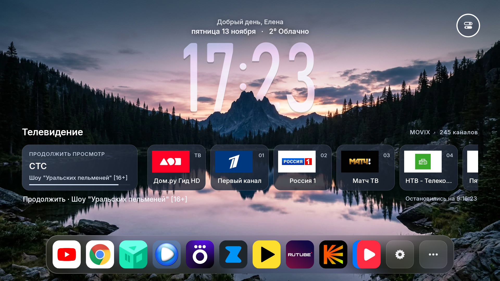
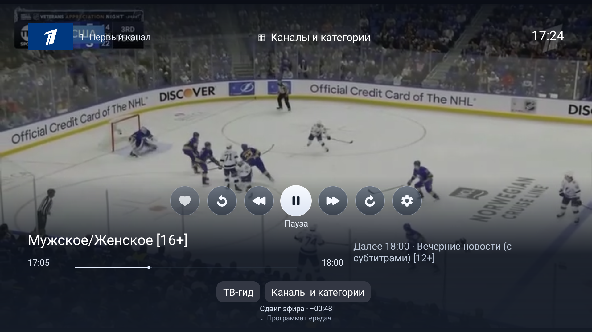
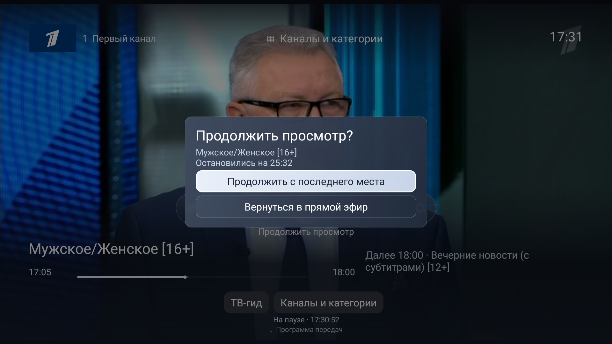

# Movix TV Client for Android TV

A community-maintained Android TV launcher and native Movix/Dom.ru client for compatible Android TV and Google TV boxes.

The project combines the original [tvOS Launcher](https://github.com/techgenius1/tvOS-Launcher) home experience with a native Movix player for live television, catch-up playback, EPG navigation, remote channel switching, archive seeking, audio/subtitle tracks, and resume choices.

> **Status:** tested on a Movix Pro / SEI200ER running Android 9 (API 28). Other Dom.ru boxes may need a different channel catalogue or firmware-specific launcher package. The project does not bypass account authentication, DRM, operator entitlements, or network restrictions.

## What it provides

- tvOS-style home screen, dock, wallpapers, widgets, settings and remote navigation.
- Native Movix player with live HLS playback and official catch-up URLs.
- EPG with current/next programme information and previous-day browsing.
- Pause, seek, start-over, return-to-live, channel number input, favourites, media buttons and audio/subtitle selection.
- Resume storage per programme. When a saved position exists, the player pauses and asks whether to continue or return to live TV.
- Safe local build and ADB installation using the Android SDK command-line tools.
- CleanYourTV-inspired recovery and debloat documentation that keeps the stock launcher recoverable.

## Important limits

This is an Android TV client for a user who has a valid Movix/Dom.ru service. It uses the operator's public device API and the account/device session supplied to the app. It is not a replacement for a Dom.ru subscription and it does not unlock channels that the account cannot view. Channel IDs and EPG data can change; update `assets/movix_channels.json` when the operator changes its catalogue.

The bundled catalogue contains public and entitlement-dependent entries. Availability is decided by the operator for the current account and region.

## Build

Requirements:

- JDK 17 or newer;
- Android SDK platform 34;
- Android build-tools 34.0.0;
- macOS/Linux shell or PowerShell on Windows.

```sh
export ANDROID_HOME="$HOME/Library/Android/sdk"
./build.sh
```

The APK is written to `build/tvos-home.apk`. The build uses a local development keystore when no release keystore is provided. Do not use a development-signed APK as an update over a differently signed release build.

## Install on a compatible TV

Read [the Dom.ru / Movix setup guide](docs/movix-domru.md) before changing the Home app. The short version is:

```sh
TV='<tv-ip>:5555'
adb connect "$TV"
adb -s "$TV" install -r build/tvos-home.apk
adb -s "$TV" shell am start -n com.techgenius.tvosmovix/.MainActivity
```

Keep the stock launcher enabled until the new Home activity is installed, focused, and confirmed after a reboot. Disable packages only with a tested device list and keep the restore record. Never uninstall the stock launcher as part of this workflow.

## Screenshots

### Home and player






### Resume choice

The resume dialog pauses playback until the viewer chooses an action.



## Documentation

- [Dom.ru / Movix installation and recovery](docs/movix-domru.md)
- [Architecture and code map](docs/architecture.md)
- [Build and install notes](docs/install.md)
- [Feature map](docs/features.md)
- [Contributing](CONTRIBUTING.md)
- [Credits and attribution](ATTRIBUTIONS.md)
- [Original upstream project notice](NOTICE)

## License and credits

This repository is a derivative work. The original launcher is Apache-2.0 and its notices are retained. See [LICENSE](LICENSE), [NOTICE](NOTICE), and [ATTRIBUTIONS.md](ATTRIBUTIONS.md) before redistributing.
